# Korea Policy Ontology

For government-relations teams and their client executives: turns a week of Korean bills, notices and news into the few decisions each client has to make, with every step sourced and approved by a person.

**[Live demo](https://ai-odyssey.github.io/korea-policy-ontology/)** · runs in the browser, no sign-in

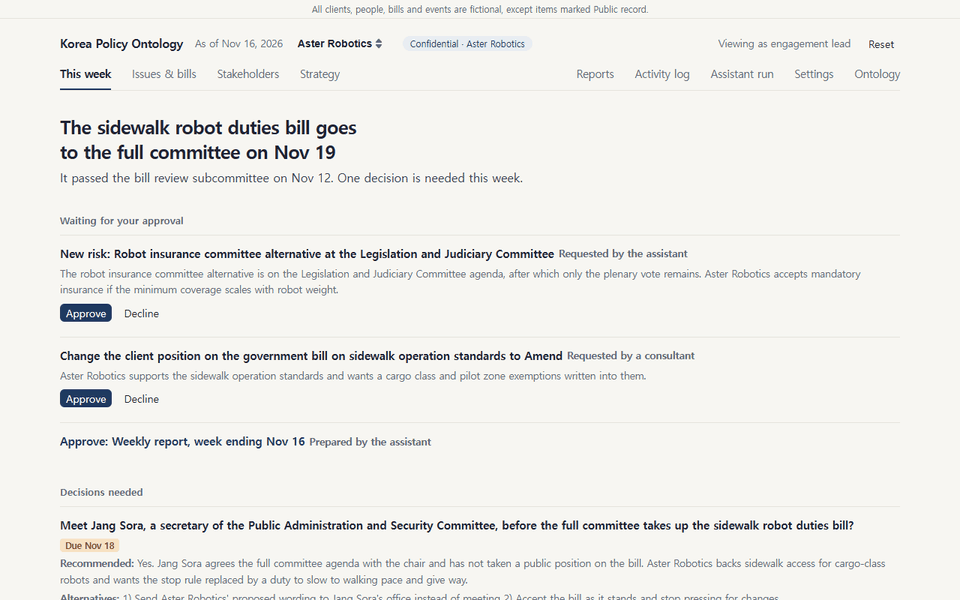

The work is modelled as an ontology of objects, links, actions and approvals that people and a rule-based assistant share. On Monday the assistant has filed the clear items, named the one lawmaker worth meeting before this week's committee vote and drafted the client report. The engagement lead approves or declines each step.

All clients, people, bills and events are fictional; the legislative procedure and institutions are real. The one exception is marked on screen: items with a "Public record" chip are real public records (bills, committee meetings, notices, the Official Gazette, press releases, news headlines) collected for each client's monitoring profile.

It is a sanitized, fictional re-implementation of the ontology behind a system I run for my own policy work, and the domain layer for Donaro, my AI task router (it decides which model or agent takes each piece of work). Read [CASE_STUDY.md](CASE_STUDY.md) for the problem and the design choices, [docs/walkthrough.md](docs/walkthrough.md) for one concrete week, and [docs/ontology.md](docs/ontology.md) for the full schema.

## The demo

The viewer is the engagement lead for one client at a time: Aster Robotics (sidewalk delivery robots), Moru Foods (cultivated protein) or Wrenfield Pay (a foreign payments firm entering Korea). Every screen shows the records shared across clients plus that client's confidential layer; an object's panel says which one it belongs to. When the demo opens it is Monday morning: the weekly assistant has run for each client, and a consultant has asked to change one of Aster's positions. Their work waits for the lead's approval.

| This week | Issues & bills |
|---|---|
| 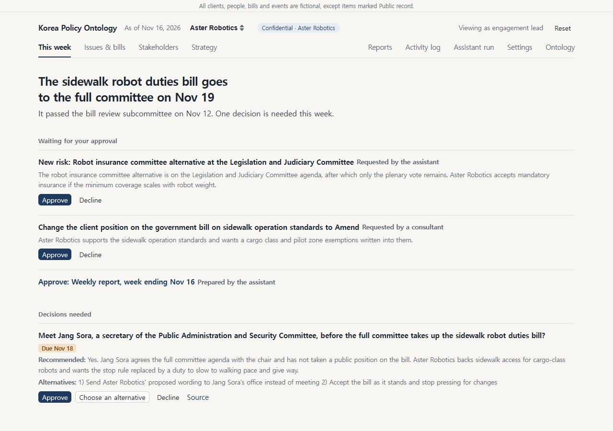 | 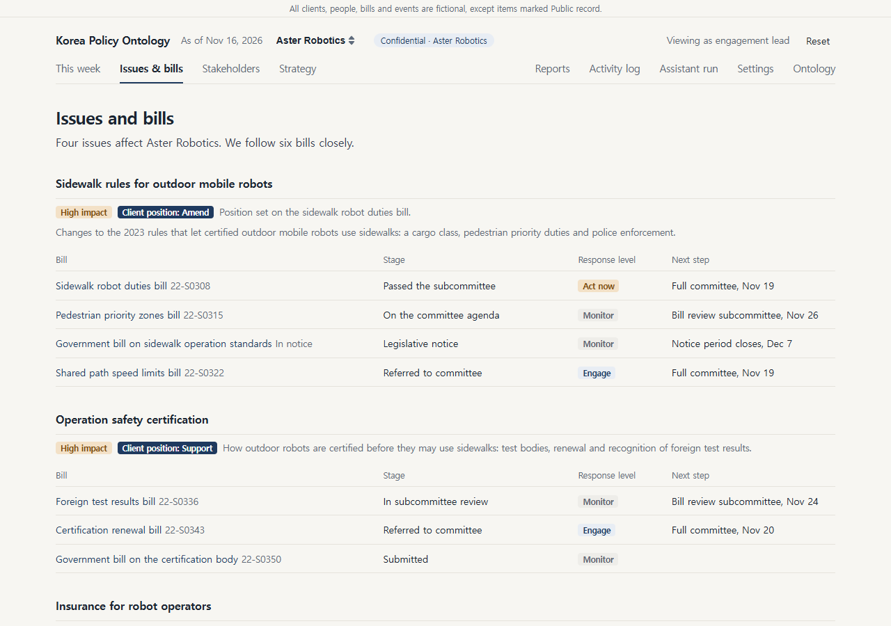 |

| Stakeholders | Strategy |
|---|---|
| 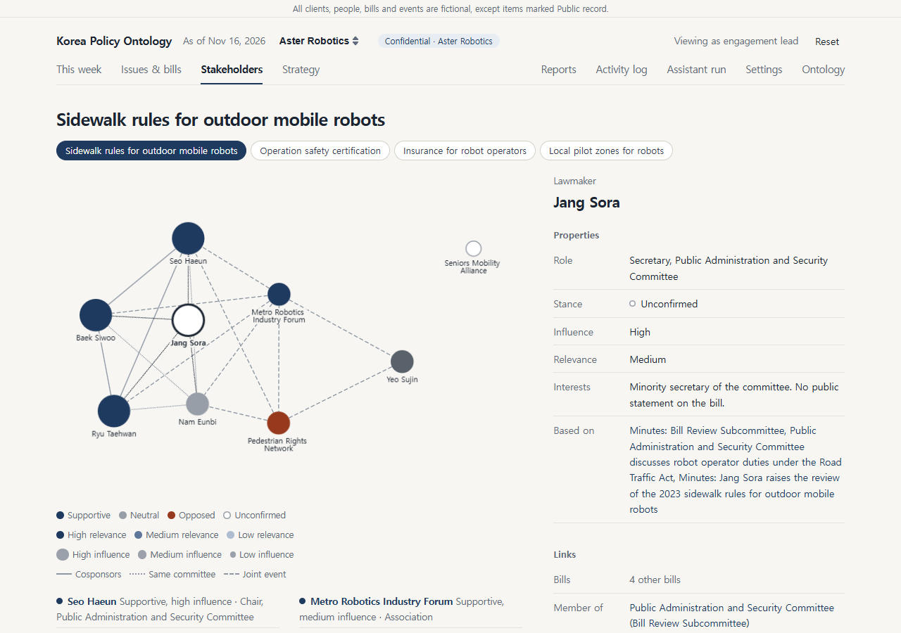 | 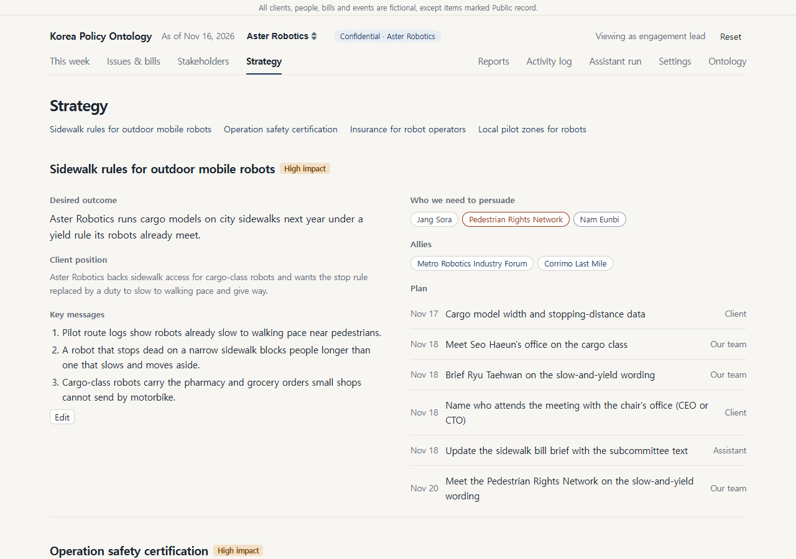 |

| Ontology | This week at phone width |
|---|---|
| 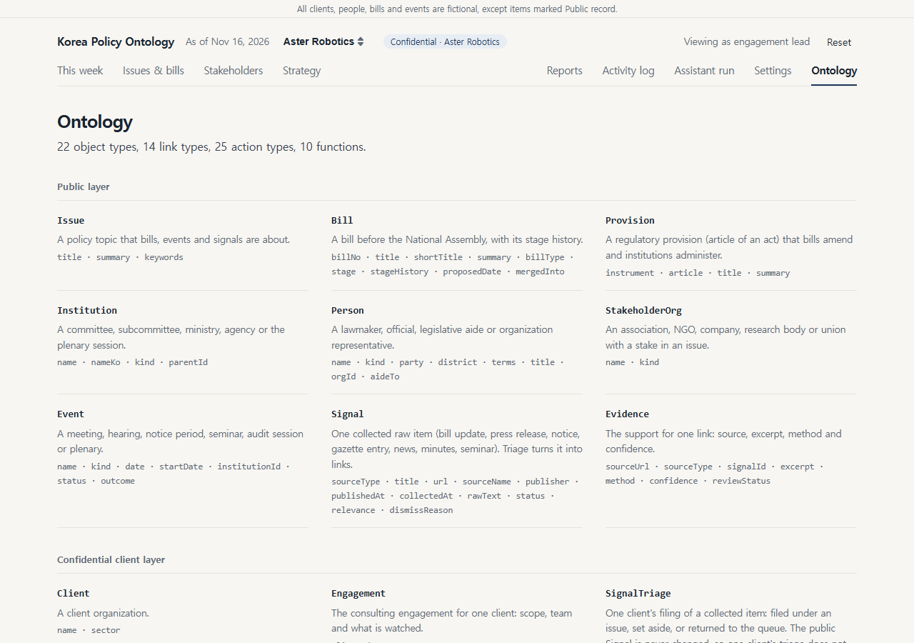 | 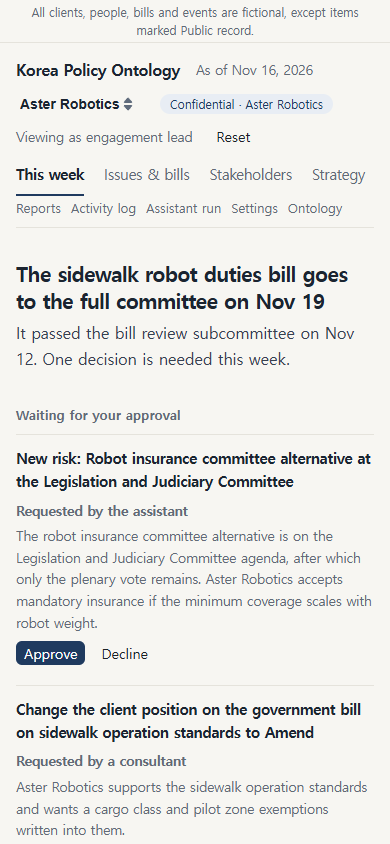 |

| Settings | Trial |
|---|---|
| 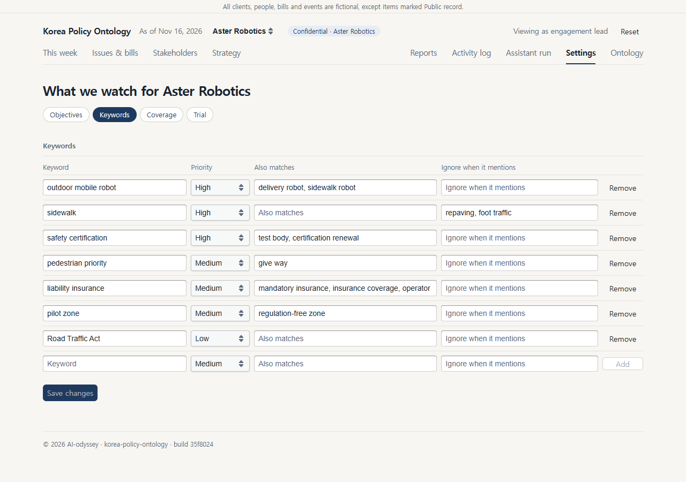 | 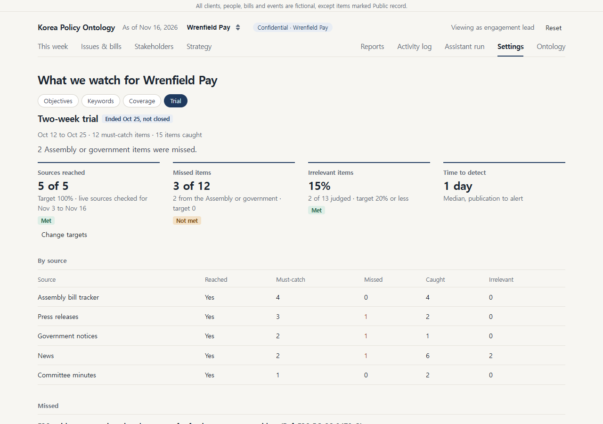 |

| Latest public records |
|---|
| 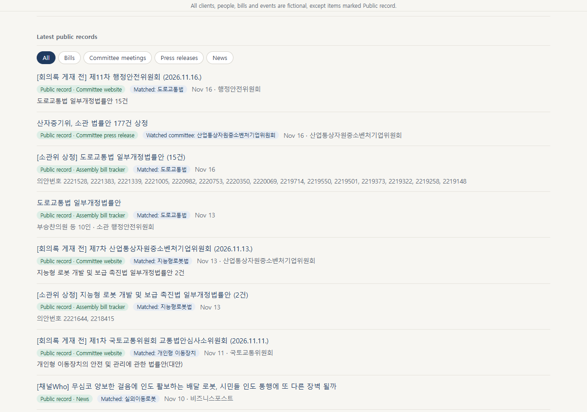 |

## How the ontology shows up in the app

Objects become screens, actions become buttons, and approvals become entries in the activity log.

| On screen | In the ontology |
|---|---|
| This week: headline | `responseLevel` on the bills the engagement follows; the most pressing one leads |
| **Waiting for your approval** | Pending requests (`addRiskOpportunity` from the assistant, `setClientPosition` or `updateStrategy` from a consultant, each with its requester) and reports in review. The Assistant run screen shows the same list |
| **Decisions needed**: **Approve**, **Choose an alternative**, **Decline**, **Source** | Open `Decision` objects and the meeting notice they were raised from; `resolveDecision`, which creates a short follow-up `Task` due before the meeting. A decision whose premise changed (the stance of the person it names) is marked **Out of date** and can be regenerated |
| **Risks** and **Opportunities** | `RiskOpportunity`, tagged high or medium impact and imminent, in progress or ongoing, in the order of the bills they concern |
| **Timeline and actions** | `upcomingDeadlines`: open `Task`s (our team, the assistant) and scheduled `Event`s |
| **Stakeholder moves** | What assessed people and organizations said or did this week: the subject of a confirmed item, a speaker in the minutes, a remark on record at a meeting, or an `Interaction` |
| **Asks of the client**, **Mark received** | `Task` with owner `client`; `completeTask` |
| **New items to confirm**, **Confirm**, **Not relevant** | The assistant's triage proposals below 0.8 confidence for this client; `triageSignal` writes a `SignalTriage` in the client's layer and never edits the shared item, so one client's filing does not change another client's queue. Items waiting here feed no report, move or decision |
| **Latest public records** (This week, Issues & bills) | Public `Signal` records (`provenance: public`) from `data/live-snapshot.json` that matched the client's monitoring profile, newest first, each with the keyword that matched and the agenda line it sits on; kept out of the fictional store, so the assistant, briefs and reports never use them |
| **Filed automatically**, **Undo** | Items the assistant filed at 0.8 or above; `reopenSignal` returns one to this client's queue |
| Issues & bills, bill profile | `Issue` (through `affects`), `Bill` (through `about`), `stageHistory`, `stageGates`, `mentions`, `ClientPosition` (every issue shows Support, Amend, Oppose or No position), and the facts behind `responseLevel`, split into why the bill matters and why it is not higher |
| **Change position** | `setClientPosition` |
| Stakeholders graph | `stakeholderNetwork`: `StakeholderAssessment` nodes, edges from public cosponsor, committee and event links |
| **Who decides at each stage** | `stageGates`: date and the chair and secretaries for the subcommittee, full committee, Legislation and Judiciary Committee and plenary |
| Object panel: Properties, Links, Actions | The selected object, its links, and **Request meeting** (`createTask`), **Update stance** (`assessStakeholder`), **Log contact** (`logInteraction`) |
| Strategy, **Edit** | `Strategy` with targets (`StakeholderAssessment`), allies (`StakeholderOrg`) and plan (`Task`); `updateStrategy` |
| Reports: **Send for review**, **Approve**, **Send to client** | `Deliverable`; `submitForReview`, `approveDeliverable`, `sendDeliverable` (simulated). The weekly report renders the same brief as This week and is rebuilt after every approval (`redraftDeliverable`); an approved report that changes goes back to review, so a stale one cannot be sent |
| Activity log | The audit log: when, who (collector, assistant, consultant, engagement lead), what, result, decided by. A request that waited for approval shows its outcome, who decided and when on its own row |
| Assistant run | The steps of `runWeeklyAgent` in plain words, and what still waits for approval |
| Settings: **Objectives**, **Keywords**, **Coverage** | `MonitoringProfile`: objectives with priority 1 to 3, keywords with priority, synonyms and exclusions, committees, agencies and source types; `updateMonitoringProfile` (a consultant's change waits for the lead). Triage scores each new item for the client with `profileMatch` |
| Settings: **Trial** | `PilotEvaluation`: the client's must-catch list (`addExpectedItem`), what the profile caught in the window (`startPilot`), **Relevant** / **Irrelevant** (`markRelevance`), targets (`setPilotCriteria`), `pilotMetrics` against them, `closePilot` |
| Ontology | `ontology/schema.ts`, rendered |

A bill carries a response level (**Act now**, **Engage**, **Monitor**, **Watch**) with its reasons. A meeting with the bill on the agenda and the close of a legislative notice period both count as a scheduled step. The rules are in `ontology/functions.ts` and [ADR-0009](docs/decisions/ADR-0009-categorical-response-levels.md), including a case the first rule got wrong.

## How the assistant picks a decision

For each followed bill at Act now, the assistant looks at the bill's next meeting, takes the people who control that agenda from `stageGates`, and picks one the client rates high influence whose stance is opposed or unconfirmed. It skips anyone an open plan step already covers. For Aster this week that is Jang Sora, a secretary of the Public Administration and Security Committee with no public position on the sidewalk robot duties bill; the chair and the other secretary are supportive and already have meetings planned. The decision names her, says why, states what Aster wants, offers the trade of accepting the bill as it stands, and is due the day before the committee meets.

## Quickstart

```bash
npm install          # Node 24 runs the .ts scripts directly
npm run dev          # demo at http://localhost:5173
npm test             # 258 tests in 14 files
npm run build        # static bundle in dist/, deployable to GitHub Pages
npm run preview      # serves the build at http://localhost:4173
```

Other scripts: `npm run seed` regenerates `data/world.json` (byte-identical for the fixed seed), `npm run validate` checks the world against the schema, `npm run docs:ontology` regenerates `docs/ontology.md`, `npm run typecheck` runs `tsc`.

The demo needs no server and no API key. The language-model adapter is off by default.

### Live data

`ingest/` collects real public items for each client profile in `ingest/profiles/` and maps them to `Signal` and `Evidence` records with `provenance: public`, `synthetic: false` and the official link. The validator accepts public records only for those two types; people, clients and the whole client layer stay synthetic, and nothing collected becomes a stakeholder assessment or a stance.

| Source | What it adds | How |
|---|---|---|
| Assembly bills and stage changes | New member, committee and government bills; agenda, committee, Legislation and Judiciary Committee and plenary steps (same-name bills on one day are grouped) | Official Open API |
| Committee minutes | Final minutes with the agenda | Official Open API |
| Committee websites | Meetings held this week before their minutes are posted, upcoming meetings with the agenda, and the minutes list | `<committee>.na.go.kr` schedule and minutes pages |
| Assembly seminars, committee press releases | Seminars and forums in the Assembly; committee announcements | Official Open API |
| Legislative and administrative notices | Draft decrees, rules and notices open for comment | opinion.lawmaking.go.kr |
| Official Gazette | Adopted decrees, ministerial rules, directives and notices (고시) | gwanbo.go.kr search |
| Ministry press releases | All ministries | korea.kr |
| News | Headlines per high- and medium-priority keyword; copies of one story from several outlets become one item | Google News RSS |

This edition includes the Assembly Open API and news connectors; the connectors for the other government sites are kept in a private edition. The snapshot in the demo covers every source above.

```bash
export ASSEMBLY_API_KEY=...      # National Assembly Open API key (open.assembly.go.kr); read from the environment only
npm run ingest -- --from 2026-11-03 --to 2026-11-16 --profile ingest/profiles/aster-robotics.json   # one profile, to ingest/out/
npm run ingest:snapshot -- --from 2026-11-03 --to 2026-11-16   # all profiles, to data/live-snapshot.json (default: last 14 days)
```

The snapshot command fetches each source once for all profiles and writes `data/live-snapshot.json`, which the demo reads at build time; the browser never calls these sources. It stores titles, links, dates, the issuing institution or outlet, and short official excerpts (agenda, proposer, notice period). For news it stores only the headline, link, outlet and date, never article text. A committee meeting is kept for a client when its agenda names one of the client's keywords. For each client it records the keywords that matched and the one line of a long agenda or grouped notice where they appear. It also stores each source's fetch result, which the Trial screen uses for "Sources reached". The committed snapshot covers 2026-11-03 to 2026-11-16, the two weeks up to the demo date. The law.go.kr API for administrative rules needs a registered user id, so finalized rules come from the Official Gazette instead.

## Architecture

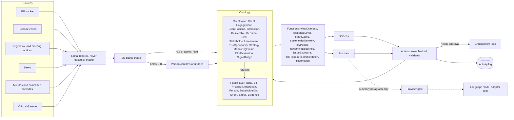

The assistant reads through the same filtered view as a person and changes state only through actions. It cannot do what its role does not allow, and it stops where a person must approve.

## Ontology at a glance

21 object types, 14 link types, 24 action types and 10 functions. The full tables, generated from `ontology/schema.ts` and checked by a test, are in [docs/ontology.md](docs/ontology.md).

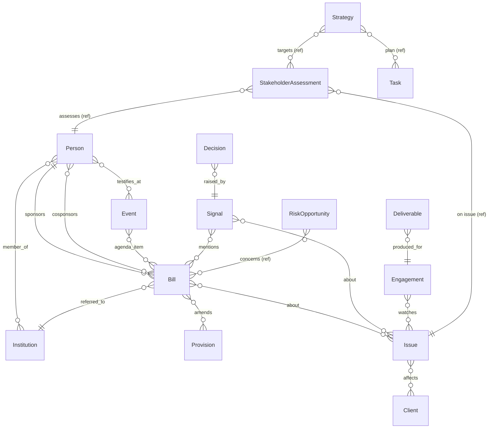

| | |
|---|---|
| Public layer (marking `PUBLIC`) | Issue, Bill, Provision, Institution, Person, StakeholderOrg, Event, Signal, Evidence |
| Client layer (marking `CLIENT:<clientId>`) | Client, Engagement, ClientPosition, Interaction, Deliverable, Decision, Task, StakeholderAssessment, RiskOpportunity, Strategy, MonitoringProfile, PilotEvaluation, SignalTriage |
| Roles | `system` (collector), `agent` (assistant), `consultant`, `principal` (shown as engagement lead) |

Every link between public objects needs at least one `Evidence` record (source, excerpt, method, confidence); the validator enforces it. A client's read of a public person is a separate `StakeholderAssessment` in that client's layer, never a property of the `Person` ([ADR-0010](docs/decisions/ADR-0010-client-judgments-in-client-layer.md)). A stance other than `unconfirmed` needs at least one basis record, and only people can set it.

## Security model in brief

Objects carry markings. Every read goes through `store.as(ctx)`, where the context is the actor, the role and the client ids the caller is assigned to; the filter sits in the runtime, below the screens. The assistant's context holds one client. One action call may touch only one client layer, so an Aster record cannot cite a Moru meeting. Activity-log entries are filed under the client whose workspace the action ran in, even when the action touched only public objects. Client-marked objects reach a language model only if the provider is on an allow-list, which is empty by default. Approval rules and the full permission matrix are in [docs/ontology.md](docs/ontology.md#permission-matrix); threats and tests are in [docs/security-model.md](docs/security-model.md).

## The fictional world

Generated by `data/seed.ts` with seed `20261116`, as of 2026-11-16, and committed as `data/world.json`. The institutions, their jurisdiction and the procedure are real: bills go to the standing committee that holds the law (robot certification and insurance to the trade and industry committee, foreign exchange to the finance, economy and planning committee), the majority secretary chairs the bill review subcommittee, committee chairs have three or more terms, government bills have no number until they leave the 40-day notice, and a committee alternative exists only once the full committee adopts it. The robot bills amend the rules in force since November 2023. Invented names were checked against the 22nd National Assembly member list and against existing companies.

| Public layer | Count | Client layer | Count |
|---|---|---|---|
| Issues | 11 | Clients | 3 |
| Bills | 33 (4 folded into an alternative, 1 withdrawn, 1 passed, 2 in legislative notice) | Engagements | 3 |
| Provisions | 18 | Client positions | 12 |
| Institutions | 20 | Interactions | 10 |
| People | 60 (36 lawmakers) | Deliverables | 7 |
| Stakeholder organizations | 13 | Decisions | 3 (the assistant raises three more on Monday) |
| Events | 41 | Tasks | 24 |
| Signals (six weeks) | 160 (109 routed before this week, 3 set aside as noise, 48 new this week) | Stakeholder assessments | 32 |
| Evidence records | 844 | Risks and opportunities | 11 |
| Links | 890 | Strategies | 11 |
| | | Monitoring profiles | 3 |
| | | Trials | 1 (Wrenfield Pay, Oct 12 to 25: 12 must-catch items, 3 missed; ended, not yet closed) |
| | | Signal triage records | none in the seed; each client's filings this week are written by its assistant and people |

## Tests

| File | Tests | What it checks |
|---|---|---|
| `tests/permissions.test.ts` | 103 | Every role against every action matches the schema; refusals are logged |
| `tests/client-layer.test.ts` | 19 | Assessments, risks, strategies, the stance-needs-a-basis rule, activity-log markings, `stageGates`, `stakeholderNetwork` |
| `tests/approval.test.ts` | 18 | Approval gate, send blocked until approval, audit log, stage rules, numbering on submission, undoing a triage |
| `tests/settings.test.ts` | 12 | Settings and trial permissions and approval, isolation, `pilotMetrics` on the seeded trial, `profileMatch` priorities, synonyms and exclusions, triage reading the profile |
| `tests/agent.test.ts` | 16 | The weekly run, decision target selection, no duplicate of a plan step, follow-up due before the meeting, the report's order and exclusions, the opening state, client scope, the provider gate in a run |
| `tests/functions.test.ts` | 13 | Determinism, risk breakdown, `responseLevel` rules including the opposed-without-a-move case, review-queue evidence ignored |
| `tests/world.test.ts` | 13 | `world.json` equals the generator output, size ranges, validator catches each rule violation |
| `tests/isolation.test.ts` | 12 | No cross-client reads, writes or references; frozen records; audit-log isolation |
| `tests/ingest.test.ts` | 15 | Assembly Open API and news parsers on recorded responses, story merging, keyword matching, the runner, mapping to `Signal` and `Evidence` |
| `tests/live.test.ts` | 11 | Matching across word boundaries, committee scope, merging differently worded copies, one fetch for several profiles, public records in the validator, the committed snapshot, trial reach from live fetch results |
| `tests/consistency.test.ts` | 15 | Per-client triage queues, citations that name the right notice, moves only where the person is the subject or speaker, unconfirmed items kept out, the report rebuilt after approvals, out-of-date decisions, notice periods in `responseLevel`, the run's wording, why a live record matched |
| `tests/gate.test.ts` | 6 | The provider gate itself |
| `tests/docs.test.ts` | 4 | `docs/ontology.md` is the generated file and lists exactly the schema |
| `tests/provenance.test.ts` | 1 | Every source file carries the copyright header |

## Repository layout

```
ontology/   schema.ts (types, links, actions, functions), runtime.ts (store, views, actions, audit),
            functions.ts, markings.ts (markings, provider gate), validate.ts, render-docs.ts
data/       seed.ts (deterministic generator), world.json, live-snapshot.json (public records)
ingest/     connectors/ (one per public source), core/ (fetching, matching, merging, runner), map.ts, snapshot.ts, profiles/
agent/      agent.ts (weekly run, decision rule, report), brief.ts (the weekly brief both This week and the report render),
            opening.ts (Monday state), triage.ts (rules), llm.ts (optional adapter, off by default)
app/        Vite, React and Blueprint demo (static)
docs/       ontology.md (generated), security-model.md, walkthrough.md, decisions/ADR-*.md, img/
tests/      vitest
```

## Decisions

| ADR | Topic |
|---|---|
| [0001](docs/decisions/ADR-0001-ontology-over-dashboard.md) | Ontology instead of a dashboard or a chatbot |
| [0002](docs/decisions/ADR-0002-signal-and-evidence.md) | Signal as an object, Evidence on every public link |
| [0003](docs/decisions/ADR-0003-markings-and-caller-context.md) | Markings and caller-context filtering |
| [0004](docs/decisions/ADR-0004-approval-gates.md) | Approval gates for client-facing actions |
| [0005](docs/decisions/ADR-0005-rules-first-triage.md) | Rules and human review for triage; the model only behind a provider gate |
| [0006](docs/decisions/ADR-0006-static-demo.md) | Static, serverless demo |
| [0007](docs/decisions/ADR-0007-deterministic-synthetic-world.md) | Deterministic synthetic world |
| [0008](docs/decisions/ADR-0008-fictional-data-policy.md) | Fictional data policy |
| [0009](docs/decisions/ADR-0009-categorical-response-levels.md) | Categorical response levels on screen, and the case the first rule missed |
| [0010](docs/decisions/ADR-0010-client-judgments-in-client-layer.md) | Client judgments about public stakeholders live in the client layer |

## Limits

This is a model and a demo. Live collection runs from the command line; the shipped build shows a committed snapshot and makes no network calls to public sources, has no authentication and no language-model calls. The response-level rules, the decision rule and the risk-score weights are set by hand and published; nothing is fitted to outcomes. State lives in the browser. See the end of [CASE_STUDY.md](CASE_STUDY.md).

---

## 한국어 요약

대관(GR) 컨설턴트는 한 주의 상당 부분을 법안 진행, 입법예고, 위원회 일정, 뉴스를 읽으며 고객사마다 중요한 몇 건을 골라내고, 이를 경영진이 판단할 수 있는 형태로 다시 쓰는 데 씁니다. 이 저장소는 그 일을 객체, 관계, 액션, 승인으로 나눠 사람과 규칙 기반 AI 비서가 함께 쓰는 온톨로지로 만든 데모입니다. 제가 실제 정책 업무에 쓰는 시스템의 구조를 가상 데이터로 다시 구현했습니다. 고객사, 인물, 법안, 일정은 모두 가상이고 국회 절차와 기관, 상임위 소관은 실제 제도를 따릅니다.

월요일 아침 화면을 열면 AI 비서가 이미 확실한 소식을 분류해 두었고, 이번 주 위원회 전에 만나야 할 의원 한 명을 골라 결정 안건으로 올렸으며, 고객사에 보낼 주간 보고서 초안도 써 두었습니다. 업무 책임자는 이를 하나씩 승인하거나 반려합니다. 만날 사람은 다음 회의의 의사일정을 쥔 위원장과 간사 가운데 영향력이 크고 입장이 확인되지 않았거나 반대하는 사람으로 정하며, 이미 계획에 잡힌 사람은 뺍니다. 법안은 점수 대신 대응 수준(Act now, Engage, Monitor, Watch)과 그 이유로 보여 줍니다. 고객사가 특정 인물을 어떻게 보는지는 공개 인물 기록과 분리해 고객사 영역에만 저장하고, 근거 기록이 있어야 하며 사람만 정할 수 있습니다. 모든 액션은 활동 기록에 남고, 다른 고객사의 기록은 화면에도 AI 비서에게도 보이지 않습니다. 서버나 API 키 없이 브라우저에서 바로 실행됩니다. "Public record" 표시가 붙은 항목만 실제 공개 기록입니다. 국회 의안·회의록·위원회 홈페이지 일정, 입법·행정예고, 관보, 부처 보도자료, 뉴스 제목을 고객사별 모니터링 키워드로 걸러 스냅숏으로 담았고, 가상 고객사 이야기와 섞지 않습니다.

## License

All rights reserved. See [LICENSE](LICENSE).
