# Reference

Details behind the [README](../README.md): how each screen maps to the ontology, the live public data, the architecture, the fictional world, the tests and the repository layout.

## Screens

The app is used directly by a company's in-house government-affairs team, and the viewer is its head of government affairs. The header select switches between three example deployments: Aster Robotics (sidewalk delivery robots), Moru Foods (cultivated protein) and Wrenfield Pay (a foreign payments firm entering Korea). Every screen shows the records shared across deployments plus that company's confidential layer; an object's panel says which one it belongs to. When the demo opens it is Monday morning: the weekly assistant has run for each company, and an analyst has asked to change one of Aster's positions. Their work waits for the head of government affairs to review.

| This week | Issues & bills |
|---|---|
| 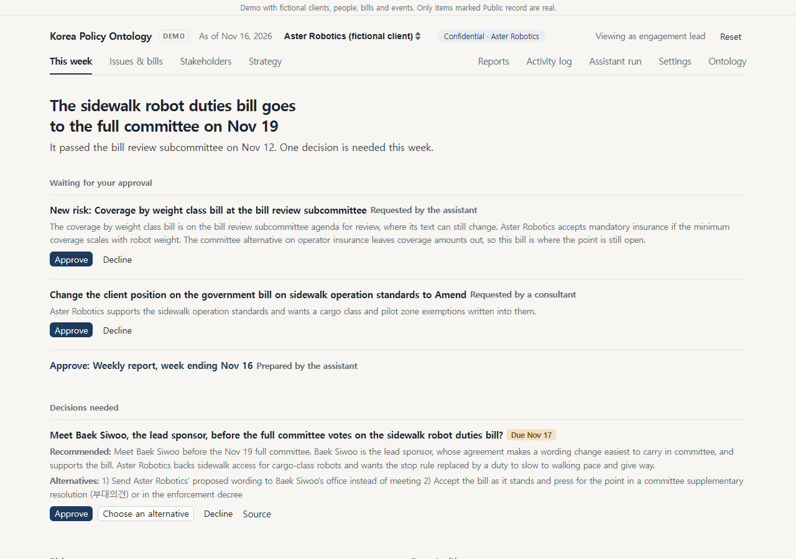 | 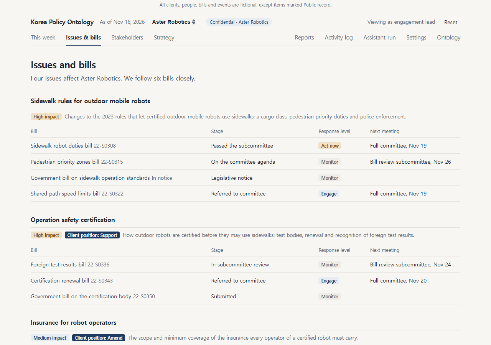 |

| Stakeholders | Strategy |
|---|---|
| 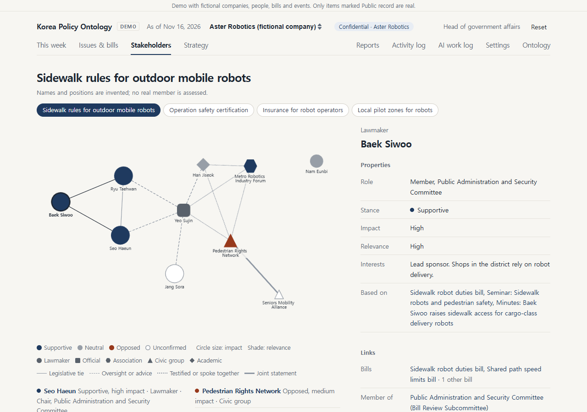 | 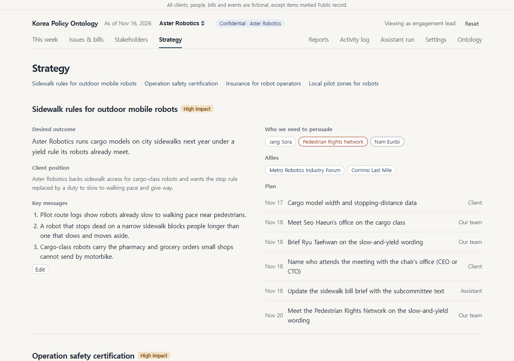 |

| Ontology | This week at phone width |
|---|---|
| 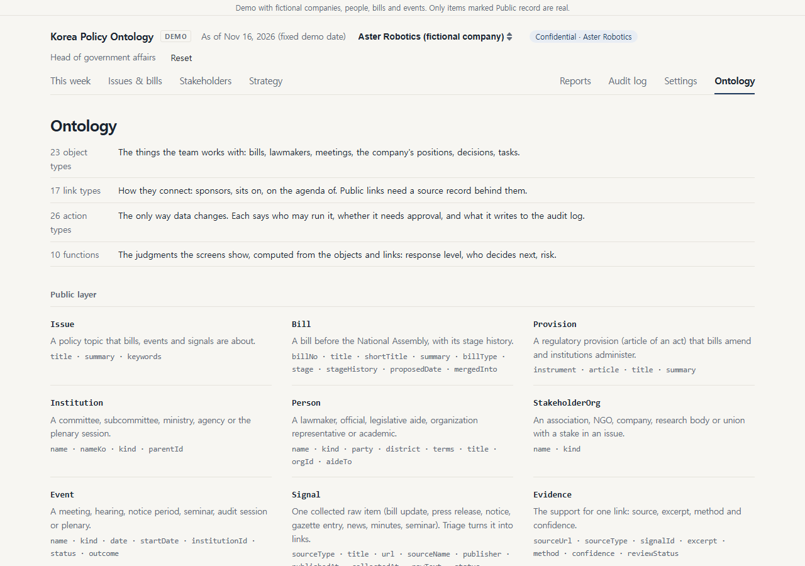 | 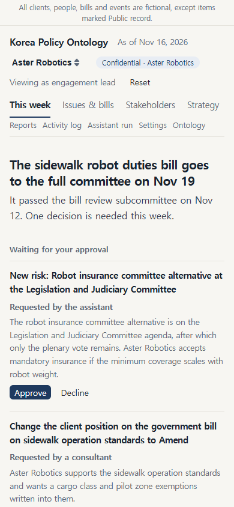 |

| Settings | Trial |
|---|---|
| 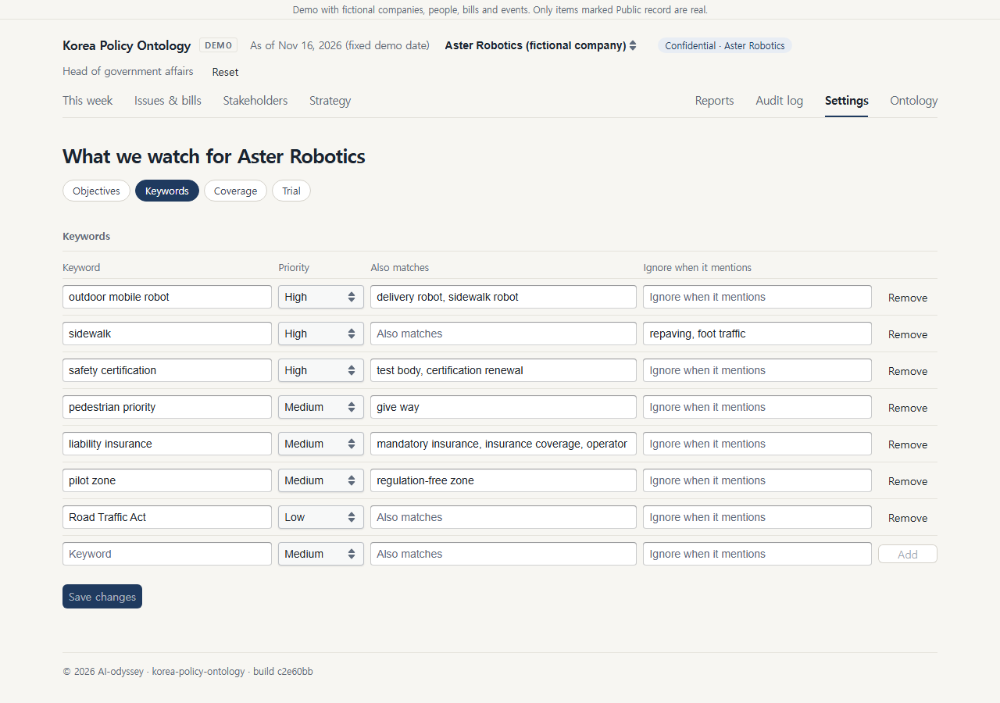 | 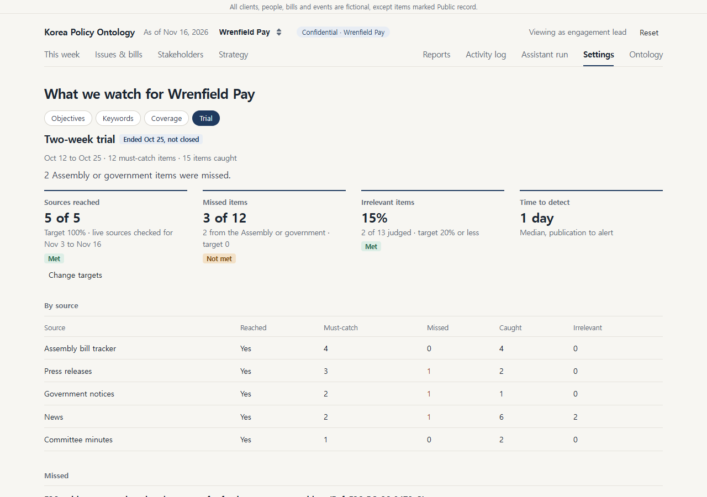 |

| Latest public records |
|---|
| 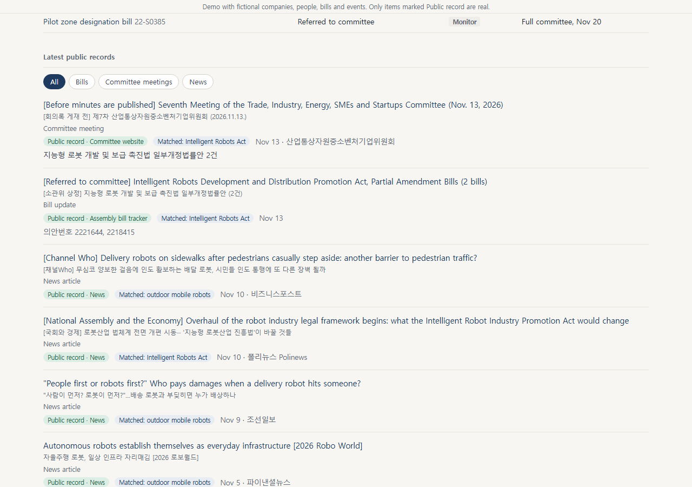 |

## How the ontology shows up in the app

Objects become screens, actions become buttons, and approvals become entries in the activity log.

| On screen | In the ontology |
|---|---|
| This week: headline | `responseLevel` on the bills the team follows; the most pressing one leads |
| **To review** | What the assistant or an analyst changed or drafted: pending requests (`addRiskOpportunity` from the assistant, `setClientPosition` or `updateStrategy` from an analyst, each saying who proposed it) and reports in review. The head of government affairs approves or declines. The AI work log screen shows the same list |
| **Decisions for leadership**: **Approve**, **Choose an alternative**, **Decline**, **Source** | Open `Decision` objects and the meeting notice they were raised from; `resolveDecision`, which creates a short follow-up `Task` due before the meeting. A decision whose premise changed (the stance of the person it names) is marked **Out of date** and can be regenerated |
| **Risks** and **Opportunities** | `RiskOpportunity`, tagged high or medium impact and imminent, in progress or ongoing, in the order of the bills they concern |
| **Timeline and actions** | Everything dated from the as-of date through the next 30 days, none cut: scheduled `Event`s, open `Task`s (the team's, the assistant's and the ones needed from other teams) and the due date of each open `Decision`. The report's Coming up lists the same window and leaves out the team's own work and open decisions |
| **Stakeholder moves** | What assessed people and organizations said or did this week: the subject of a confirmed item, a speaker in the minutes, a remark on record at a meeting, or an `Interaction` |
| **Needed from other teams**, **Mark received** | `Task` with owner `client`, whose title ends with the team that has to provide it (for example "Cargo model width and stopping-distance data · Engineering"); `completeTask` |
| **New items to confirm**, **Confirm**, **Not relevant** | The assistant's triage proposals below 0.8 confidence for this company; `triageSignal` writes a `SignalTriage` in the company's layer and never edits the shared item, so one company's filing does not change another's queue. Items waiting here feed no report, move or decision |
| **Latest public records** (This week, Issues & bills) | Public `Signal` records (`provenance: public`) from `data/live-snapshot.json` that matched the company's monitoring profile, newest first, each with the keyword that matched and the agenda line it sits on; kept out of the fictional store, so the assistant, briefs and reports never use them |
| **Filed automatically**, **Undo** | Items the assistant filed at 0.8 or above; `reopenSignal` returns one to this company's queue |
| Issues & bills, bill profile | `Issue` (through `affects`), `Bill` (through `about`), `stageHistory`, `stageGates`, `mentions`, `ClientPosition` (every issue shows Support, Amend, Oppose or No position), and the facts behind `responseLevel`, split into why the bill matters and why it is not higher |
| **Change position** | `setClientPosition` |
| Stakeholders graph | `stakeholderNetwork`: `StakeholderAssessment` nodes (lawmakers, officials, associations, civic groups, academics), edges typed by the actors they join and derived from public links: co-sponsored bill, oversight (the chair or a secretary of the committee whose jurisdiction, from `referred_to`, `amends` and `regulates`, covers the official's agency), `advises`, shared `testifies_at` events on the issue between non-lawmakers, `coalition_with` joint statements |
| **Who decides at each stage** | `stageGates`: date and the chair and secretaries for the subcommittee, full committee, Legislation and Judiciary Committee and plenary |
| Object panel: Properties, Links, Actions | The selected object, its links, and **Request meeting** (`createTask`), **Update stance** (`assessStakeholder`), **Log contact** (`logInteraction`) |
| Strategy, **Edit** | `Strategy` with targets (`StakeholderAssessment`), allies (`StakeholderOrg`) and plan (`Task`); `updateStrategy` |
| Reports: **Send for review**, **Approve**, **Send to leadership** | `Deliverable`; `submitForReview`, `approveDeliverable`, `sendDeliverable` (simulated). The weekly report renders the same brief as This week and is rebuilt after every approval (`redraftDeliverable`); an approved report that changes goes back to review, so a stale one cannot be sent |
| Activity log | The audit log: when, who (collector, assistant, analyst, head of government affairs), what, result, decided by. A request that waited for approval shows its outcome, who decided and when on its own row |
| AI work log | The steps of `runWeeklyAgent` in plain words, and what still waits for review |
| Settings: **Objectives**, **Keywords**, **Coverage** | `MonitoringProfile`: objectives with priority 1 to 3, keywords with priority, synonyms and exclusions, committees, agencies and source types; `updateMonitoringProfile` (an analyst's change waits for the head of government affairs). Triage scores each new item for the company with `profileMatch` |
| Settings: **Trial** | `PilotEvaluation`: the team's must-catch list (`addExpectedItem`), what the profile caught in the window (`startPilot`), **Relevant** / **Irrelevant** (`markRelevance`), targets (`setPilotCriteria`), `pilotMetrics` against them, `closePilot` |
| Ontology | `ontology/schema.ts`, rendered |

A bill carries a response level (**Act now**, **Engage**, **Monitor**, **Watch**) with its reasons. A meeting with the bill on the agenda and the close of a legislative notice period both count as a scheduled step. The rules are in `ontology/functions.ts` and [ADR-0009](decisions/ADR-0009-categorical-response-levels.md), including a case the first rule got wrong.

## How the assistant picks a decision

For each followed bill at Act now, the assistant looks at the bill's next meeting, takes the people who control that agenda from `stageGates`, and picks one the company rates high influence whose stance is opposed or unconfirmed. It skips anyone an open plan step already covers. For Aster this week that is Baek Siwoo, the lead sponsor of the sidewalk robot duties bill; the committee chair and the subcommittee chair already have plan steps (a briefing on timing, a briefing on the wording). The decision names him, says why, states what Aster wants, offers the trade of accepting the bill as it stands, and is due two working days before the committee meets, or today when the meeting is too close.

## Live data

`ingest/` collects real public items for each company profile in `ingest/profiles/` and maps them to `Signal` and `Evidence` records with `provenance: public`, `synthetic: false` and the official link. The validator accepts public records only for those two types; people, companies and the whole company layer stay synthetic, and nothing collected becomes a stakeholder assessment or a stance.

| Source | What it adds | Connector |
|---|---|---|
| Assembly bills and stage changes | New member, committee and government bills; agenda, committee, Legislation and Judiciary Committee and plenary steps (same-name bills on one day are grouped) | Published (official Open API) |
| Committee minutes | Final minutes with the agenda | Published (official Open API) |
| Assembly seminars, committee press releases | Seminars and forums in the Assembly; committee announcements | Published (official Open API) |
| Committee websites | Meetings held this week before their minutes are posted, upcoming meetings with the agenda, and the minutes list | Not published |
| Legislative and administrative notices | Draft decrees, rules and notices open for comment | Not published |
| Official Gazette | Adopted decrees, ministerial rules, directives and notices | Not published |
| Government press releases | Releases from the ministries | Not published |
| News | Headlines per high- and medium-priority keyword; copies of one story from several outlets become one item | Published |

This repository includes the connectors marked Published. The others are not published, so the committed snapshot covers every source above but can be read here, not rebuilt.

```bash
export ASSEMBLY_API_KEY=...      # National Assembly Open API key (open.assembly.go.kr); read from the environment only
npm run ingest -- --from 2026-11-03 --to 2026-11-16 --profile ingest/profiles/aster-robotics.json   # one profile, to ingest/out/
npm run ingest:snapshot -- --from 2026-11-03 --to 2026-11-16   # all profiles, to data/live-snapshot.json (default: last 14 days)
```

The snapshot command fetches each source once for all profiles and writes `data/live-snapshot.json`, which the demo reads at build time; the browser never calls these sources. It stores titles, links, dates, the issuing institution or outlet, and short official excerpts (agenda, proposer, notice period). For news it stores only the headline, link, outlet and date, never article text. A committee meeting is kept for a client when its agenda names one of the client's keywords. For each client it records the keywords that matched and the one line of a long agenda or grouped notice where they appear. It also stores each source's fetch result, which the Trial screen uses for "Sources reached". The committed snapshot covers 2026-11-03 to 2026-11-16, the two weeks up to the demo date.

## Architecture

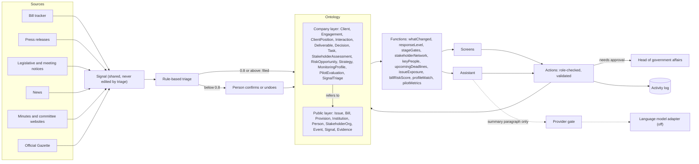

The assistant reads through the same filtered view as a person and changes state only through actions. It cannot do what its role does not allow, and it stops where a person must approve.

## Ontology at a glance

21 object types, 14 link types, 24 action types and 10 functions. The full tables, generated from `ontology/schema.ts` and checked by a test, are in [docs/ontology.md](ontology.md).

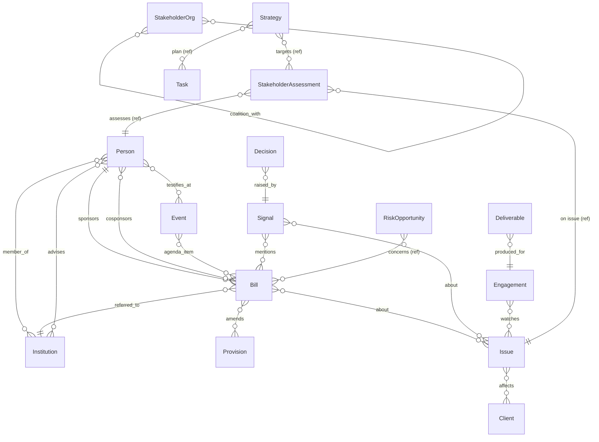

| | |
|---|---|
| Public layer (marking `PUBLIC`) | Issue, Bill, Provision, Institution, Person, StakeholderOrg, Event, Signal, Evidence |
| Company layer (marking `CLIENT:<clientId>`; the type names keep the word client) | Client, Engagement, ClientPosition, Interaction, Deliverable, Decision, Task, StakeholderAssessment, RiskOpportunity, Strategy, MonitoringProfile, PilotEvaluation, SignalTriage |
| Roles | `system` (collector), `agent` (assistant), `consultant` (shown as analyst), `principal` (shown as head of government affairs) |

Every link between public objects needs at least one `Evidence` record (source, excerpt, method, confidence); the validator enforces it. The company's read of a public person is a separate `StakeholderAssessment` in the company's layer, never a property of the `Person` ([ADR-0010](decisions/ADR-0010-client-judgments-in-client-layer.md)). A stance other than `unconfirmed` needs at least one basis record, and only people can set it.

## Security model in brief

Objects carry markings. Every read goes through `store.as(ctx)`, where the context is the actor, the role and the company ids the caller is assigned to; the filter sits in the runtime, below the screens. The assistant's context holds one company. One action call may touch only one company layer, so an Aster record cannot cite a Moru meeting. Activity-log entries are filed under the company whose workspace the action ran in, even when the action touched only public objects. Objects with a company marking reach a language model only if the provider is on an allow-list, which is empty by default. Approval rules and the full permission matrix are in [docs/ontology.md](ontology.md#permission-matrix); threats and tests are in [docs/security-model.md](security-model.md).

## The fictional world

Generated by `data/seed.ts` with seed `20261116`, as of 2026-11-16, and committed as `data/world.json`. The institutions, their jurisdiction and the procedure are real: bills go to the standing committee that holds the law (robot certification and insurance to the trade and industry committee, foreign exchange to the finance, economy and planning committee), the majority secretary chairs the bill review subcommittee, committee chairs have three or more terms, government bills have no number until they leave the 40-day notice, and a committee alternative exists only once the full committee adopts it. The robot bills amend the rules in force since November 2023. Invented names were checked against the 22nd National Assembly member list and against existing companies.

| Public layer | Count | Company layer | Count |
|---|---|---|---|
| Issues | 11 | Companies (`Client`) | 3 |
| Bills | 33 (4 folded into an alternative, 1 withdrawn, 1 passed, 2 in legislative notice) | Monitoring setups (`Engagement`) | 3 |
| Provisions | 18 | Company positions | 12 |
| Institutions | 20 | Interactions | 10 |
| People | 60 (36 lawmakers) | Deliverables | 7 |
| Stakeholder organizations | 13 | Decisions | 3 (the assistant raises three more on Monday) |
| Events | 41 | Tasks | 24 |
| Signals (six weeks) | 160 (109 routed before this week, 3 set aside as noise, 48 new this week) | Stakeholder assessments | 32 |
| Evidence records | 844 | Risks and opportunities | 11 |
| Links | 890 | Strategies | 11 |
| | | Monitoring profiles | 3 |
| | | Trials | 1 (Wrenfield Pay, Oct 12 to 25: 12 must-catch items, 3 missed; ended, not yet closed) |
| | | Signal triage records | none in the seed; each company's filings this week are written by its assistant and people |

## Tests

| File | What it checks |
|---|---|
| `tests/permissions.test.ts` | Every role against every action matches the schema; refusals are logged |
| `tests/client-layer.test.ts` | Assessments, risks, strategies, the stance-needs-a-basis rule, activity-log markings, `stageGates`, `stakeholderNetwork` |
| `tests/approval.test.ts` | Approval gate, send blocked until approval, audit log, stage rules, numbering on submission, undoing a triage |
| `tests/settings.test.ts` | Settings and trial permissions and approval, isolation, `pilotMetrics` on the seeded trial, `profileMatch` priorities, synonyms and exclusions, triage reading the profile |
| `tests/agent.test.ts` | The weekly run, decision target selection, no duplicate of a plan step, follow-up due before the meeting, the report's order and exclusions, the opening state, company scope, the provider gate in a run |
| `tests/functions.test.ts` | Determinism, risk breakdown, `responseLevel` rules including the opposed-without-a-move case, review-queue evidence ignored |
| `tests/world.test.ts` | `world.json` equals the generator output, size ranges, validator catches each rule violation |
| `tests/isolation.test.ts` | No cross-company reads, writes or references; frozen records; audit-log isolation |
| `tests/ingest.test.ts` | Assembly Open API and news parsers on recorded responses, story merging, keyword matching, the runner, mapping to `Signal` and `Evidence` |
| `tests/live.test.ts` | Matching across word boundaries, committee scope, merging differently worded copies, one fetch for several profiles, public records in the validator, the committed snapshot, trial reach from live fetch results |
| `tests/consistency.test.ts` | Per-company triage queues, citations that name the right notice, moves only where the person is the subject or speaker, unconfirmed items kept out, the report rebuilt after approvals, out-of-date decisions, notice periods in `responseLevel`, the run's wording, why a live record matched |
| `tests/gate.test.ts` | The provider gate itself |
| `tests/docs.test.ts` | `docs/ontology.md` is the generated file and lists exactly the schema |
| `tests/provenance.test.ts` | Every source file carries the copyright header |

## Repository layout

```
ontology/   schema.ts (types, links, actions, functions), runtime.ts (store, views, actions, audit),
            functions.ts, markings.ts (markings, provider gate), validate.ts, render-docs.ts
data/       seed.ts (deterministic generator), world.json, live-snapshot.json (public records)
ingest/     connectors/ (one per public source), core/ (fetching, matching, merging, runner), map.ts, snapshot.ts, profiles/
agent/      agent.ts (weekly run, decision rule, report), brief.ts (the weekly brief both This week and the report render),
            opening.ts (Monday state), triage.ts (rules), llm.ts (optional adapter, off by default)
app/        Vite, React and Blueprint demo (static)
docs/       ontology.md (generated), security-model.md, walkthrough.md, decisions/ADR-*.md, img/
tests/      vitest
```

## Decisions

| ADR | Topic |
|---|---|
| [0001](decisions/ADR-0001-ontology-over-dashboard.md) | Ontology instead of a dashboard or a chatbot |
| [0002](decisions/ADR-0002-signal-and-evidence.md) | Signal as an object, Evidence on every public link |
| [0003](decisions/ADR-0003-markings-and-caller-context.md) | Markings and caller-context filtering |
| [0004](decisions/ADR-0004-approval-gates.md) | Approval gates for actions that reach leadership |
| [0005](decisions/ADR-0005-rules-first-triage.md) | Rules and human review for triage; the model only behind a provider gate |
| [0006](decisions/ADR-0006-static-demo.md) | Static, serverless demo |
| [0007](decisions/ADR-0007-deterministic-synthetic-world.md) | Deterministic synthetic world |
| [0008](decisions/ADR-0008-fictional-data-policy.md) | Fictional data policy |
| [0009](decisions/ADR-0009-categorical-response-levels.md) | Categorical response levels on screen, and the case the first rule missed |
| [0010](decisions/ADR-0010-client-judgments-in-client-layer.md) | The company's judgments about public stakeholders live in the company layer |

## Limits

This is a model and a demo. Live collection runs from the command line; the shipped build shows a committed snapshot and makes no network calls to public sources, has no authentication and no language-model calls. The response-level rules, the decision rule and the risk-score weights are set by hand and published; nothing is fitted to outcomes. State lives in the browser. See the end of [CASE_STUDY.md](../CASE_STUDY.md).
